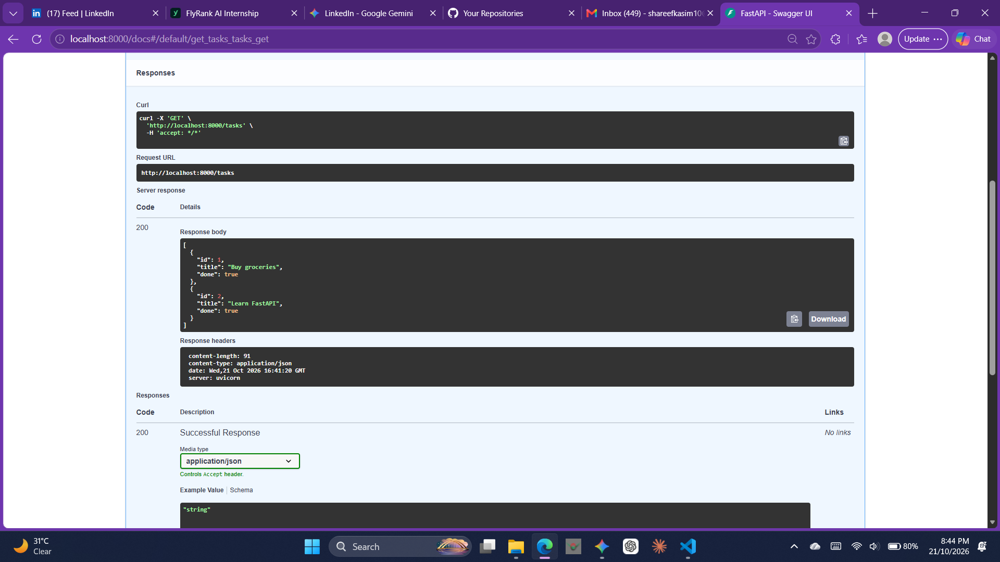
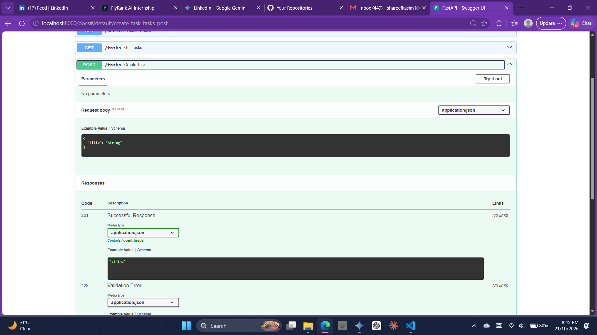
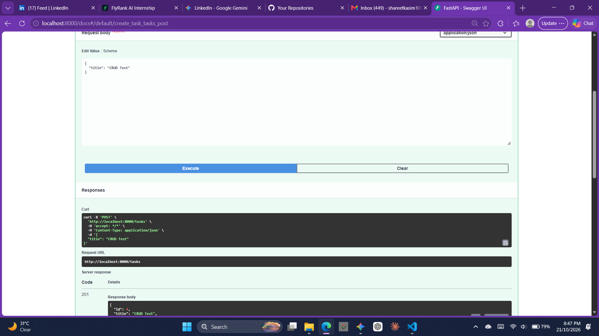

# FastAPI Task Management API

A lightweight, fully functional RESTful Task CRUD API built with Python, FastAPI, and Pydantic as an incremental backend project.

---

## Features & Endpoints

* **`GET /`** — Root endpoint returning API version and info.
* **`GET /health`** — Health check status.
* **`GET /tasks`** — Retrieve all tasks in memory.
* **`GET /tasks/{id}`** — Retrieve a specific task by ID (returns `404` if not found).
* **`POST /tasks`** — Create a new task with title validation (returns `201 Created` or `400 Bad Request`).
* **`PUT /tasks/{id}`** — Update an existing task's title or status.
* **`DELETE /tasks/{id}`** — Delete a task by ID (returns `204 No Content`).

---

## Tech Stack

* **Language:** Python
* **Framework:** FastAPI
* **Validation:** Pydantic
* **Server:** Uvicorn
* **Interactive Docs:** Swagger UI (`/docs`)

---

## Getting Started

### 1. Prerequisites & Virtual Environment
Ensure Python is installed, then activate your virtual environment:

```powershell
.\venv\Scripts\Activate.ps1
```

## API Screenshots (Swagger UI)

### 1. GET Request Output


### 2. POST Task Functional View


### 3. Successful Server Response


---
### SQLite Exploration (Stage 4)
* **Query Ran**: `SELECT COUNT(*) FROM tasks;`
* **Result**: Returned the total row count from the database, verifying that manual updates made in DB Browser reflect instantly through the live API without requiring a server restart.